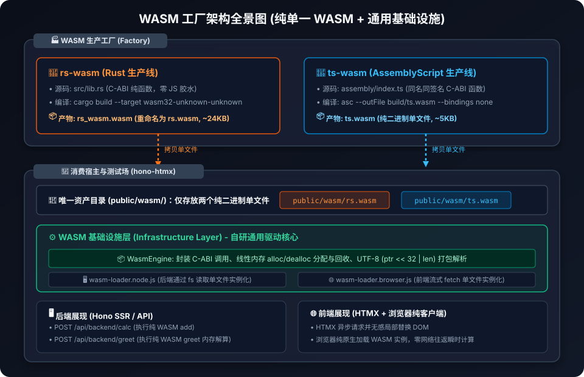
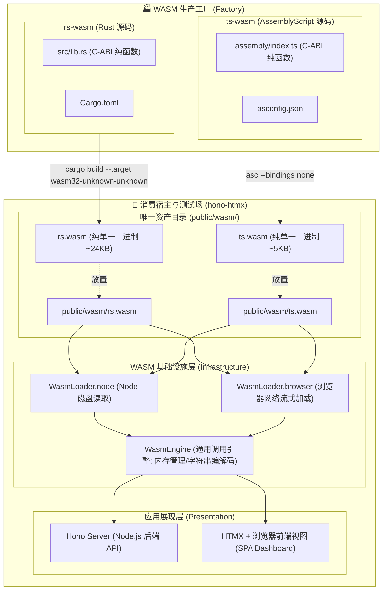

# 02. 系统架构与详细设计说明书

---

## 一、 系统整体架构图

整个项目划分为两层：**产出端（生产层）** 与 **消费端（应用层与测试场）**。

### 1. 架构矢量图 (即开即显)



---

### 2. 纯文本字符架构图 (终端 / 任何 Markdown 阅读器免插件通用)

```text
┌─────────────────────────────────────────────────────────────────────────────────────────────────┐
│                                   🏭 WASM 生产工厂 (Factory)                                     │
├─────────────────────────────────────────────────┬───────────────────────────────────────────────┤
│          🦀 rs-wasm (Rust 生产线)               │         🚀 ts-wasm (AssemblyScript 生产线)     │
│  • 源码: src/lib.rs (C-ABI 纯函数)              │  • 源码: assembly/index.ts (C-ABI 纯函数)     │
│  • 依赖: Cargo.toml (零外部运行时)              │  • 配置: asconfig.json                        │
│  • 构建命令:                                    │  • 构建命令:                                  │
│    cargo build --target wasm32-unknown-unknown  │    asc assembly/index.ts --bindings none      │
└───────────────────────┬─────────────────────────┴───────────────────────┬───────────────────────┘
                        │                                                 │
           产出单一二进制 │ (rs.wasm ~24KB)                    产出单一二进制 │ (ts.wasm ~5KB)
                        ▼                                                 ▼
┌─────────────────────────────────────────────────────────────────────────────────────────────────┐
│                               🏢 消费宿主与测试场 (hono-htmx)                                   │
├─────────────────────────────────────────────────────────────────────────────────────────────────┤
│  📁 唯一资产目录 (public/wasm/)                                                                 │
│  ┌──────────────────────────────────────┬────────────────────────────────────────────────────┐  │
│  │ 🦀 public/wasm/rs.wasm               │ 🚀 public/wasm/ts.wasm                             │  │
│  └──────────────────┬───────────────────┴──────────────────┬─────────────────────────────────┘  │
│                     │                                      │                                    │
│                     └───────────────────┬──────────────────┘                                    │
│                                         ▼                                                       │
│  ⚙️ WASM 基础设施层 (Infrastructure Layer - 自研通用驱动核心)                                     │
│  ┌───────────────────────────────────────────────────────────────────────────────────────────┐  │
│  │ 📦 WasmEngine: 封装 C-ABI 调用、线性内存 alloc/dealloc、UTF-8 (ptr << 32 | len) 打包解析   │  │
│  ├─────────────────────────────────────────────┬─────────────────────────────────────────────┤  │
│  │ 🖥️ wasm-loader.node.js (后端磁盘读取加载)    │ 🌐 wasm-loader.browser.js (前端流式网络加载) │  │
│  └──────────────────────┬──────────────────────┴──────────────────────┬──────────────────────┘  │
│                         │                                             │                         │
│                         ▼                                             ▼                         │
│  🖥️ 后端展现 (Hono SSR / API)                                 🌐 前端展现 (浏览器客户端 / HTMX) │
│  • POST /api/backend/calc (执行纯 WASM add)                   • 纯客户端原生直接执行 (零网络往返) │
│  • POST /api/backend/greet (纯 WASM 内存解算)                 • HTMX 异步无感局部刷新 DOM       │
│  • 耗时分析与模块大小统计                                     • 4 维度跑马对比矩阵               │
└─────────────────────────────────────────────────────────────────────────────────────────────────┘
```

<details>
<summary>🔍 点击展开/折叠原始 Mermaid 源码</summary>



</details>

> 💡 **架构图呈现机制说明**：
> - **SVG 矢量图**：基于纯 XML 规范原生手写生成于 `docs/assets/architecture.svg`，具有无损放大、零三方绘图软件依赖、Git 差异追踪等特性，在所有 Markdown 预览器中即开即显。
> - **纯文本字符图**：利用 Unicode 制表符保证在纯命令行终端（如 `cat`、Git 终端）与无图片环境下 100% 可视。
> - **可选 IDE 插件**：若想在 VS Code 预览器中直接交互式渲染 Mermaid 源码，可安装插件 `Markdown Preview Mermaid Support` (ID: `bierner.markdown-mermaid`)。

---

## 二、 模块职责与分层设计

### 1. `rs-wasm` (Rust 生产模块)
- **职责**：编写严谨、高性能的核心逻辑，导出标准的 C-ABI 符号。
- **核心文件**：
  - `src/lib.rs`：无 `wasm-bindgen` 宏修饰，使用 `#[no_mangle] pub extern "C"` 导出。
  - `Cargo.toml`：配置动态库 `crate-type = ["cdylib", "rlib"]`。
- **依赖**：无任何运行时额外依赖（仅标准库内存分配）。

### 2. `ts-wasm` (AssemblyScript 生产模块)
- **职责**：使用强类型 TypeScript 语法编写核心逻辑，编译为纯字节码。
- **核心文件**：
  - `assembly/index.ts`：导出与 Rust 完全同名的 C-ABI 函数。
  - `asconfig.json`：编译器参数配置。
- **依赖**：开发时依赖 `assemblyscript`，运行时**零依赖**。

### 3. `hono-htmx` (消费宿主与综合测试场)
遵循整洁架构（Clean Architecture）原则进行分层：

| 分层 | 目录 / 文件 | 职责说明 |
| :--- | :--- | :--- |
| **资产层 (Asset)** | `public/wasm/` | 仅存放纯单一二进制文件（`rs.wasm` 和 `ts.wasm`），前后端统一源头。 |
| **基础设施层 (Infra)** | `src/infrastructure/wasm/wasm-engine.js` | 跨端通用的 WebAssembly 交互引擎，封装内存交互与调用。 |
|  | `src/infrastructure/wasm/wasm-loader.node.js` | 服务端加载器：使用 Node.js `fs.readFile` 读取单一 `.wasm` 并实例化。 |
|  | `public/infrastructure/wasm/wasm-loader.browser.js` | 浏览器加载器：使用 `fetch` / `instantiateStreaming` 实例化单一 `.wasm`。 |
| **服务层 (Server)** | `src/server.js` | 基于 Hono 的轻量级后端服务，托管静态页面，响应 HTMX 表单请求。 |
| **展现层 (View)** | `public/index.html` | 现代化暗黑风格仪表盘，集成 HTMX 超媒体交互与前端原生 WASM 执行。 |

---

## 三、 C-ABI 标准通信协议规范

为了实现**任何宿主语言通用**，我们为 WASM 工厂制定了统一的标准交互规范：

### 1. 基础算术运算规范 (Zero-Copy)
- **函数签名**：`add(a: i32, b: i32) -> i32`
- **协议机制**：直接利用 WebAssembly 原生 i32 寄存器传递数值，零内存分配，开销趋近于零。

### 2. 线性内存与字符串传递规范 (Universal Memory Protocol)
由于 WebAssembly 原生仅支持数值（i32, i64, f32, f64），传递字符串等复杂数据必须通过共享线性内存（Linear Memory）：

#### 步骤 A：内存分配 (`alloc`)
- 签名：`alloc(size: usize) -> *mut u8`
- 规则：宿主向 WASM 申请 `size` 字节的线性内存，WASM 返回起始指针 `inPtr`。

#### 步骤 B：数据写入
- 规则：宿主将输入的字符串按 UTF-8 编码，直接拷贝写入 WASM 的 `memory.buffer` 中起始为 `inPtr` 的空间。

#### 步骤 C：函数调用与结果打包 (`greet`)
- 签名：`greet(inPtr: *const u8, inLen: usize) -> u64`
- 规则：
  - 函数读取输入字符串并执行业务逻辑；
  - 函数在内部申请一块空间保存输出文本；
  - **核心技巧**：函数返回一个 64 位无符号整数（u64 / BigInt），高 32 位为输出内存指针，低 32 位为输出文本的字节长度：
    $$\text{packed} = (\text{outPtr} \ll 32) \mid (\text{outLen} \ \& \ \text{0xFFFFFFFF})$$
  - 这种设计无需二次发起调用去获取长度，线程安全且完全无状态。

#### 步骤 D：结果读取与内存释放 (`dealloc`)
- 签名：`dealloc(ptr: *mut u8, size: usize)`
- 规则：宿主解包出 `outPtr` 与 `outLen`，从线性内存读取 UTF-8 文本并解码，最后调用 `dealloc` 分别释放输入和输出的内存空间，杜绝内存泄漏。
